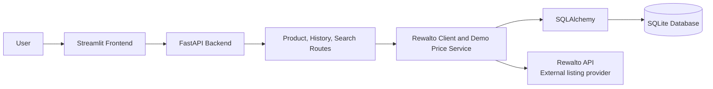
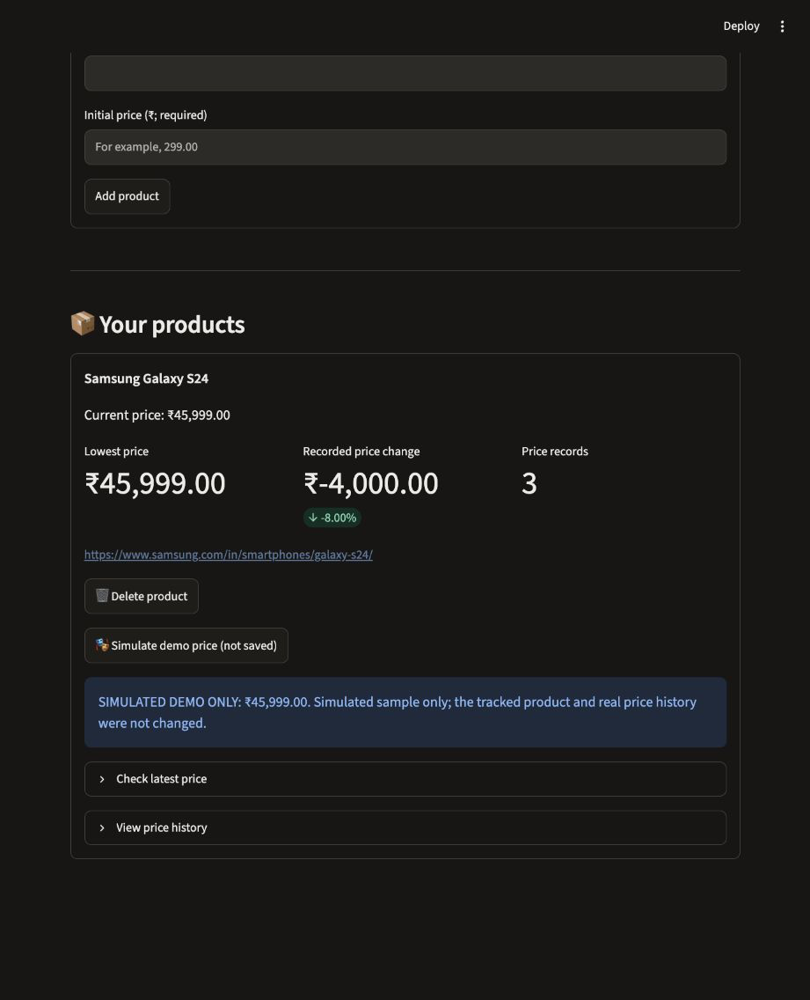
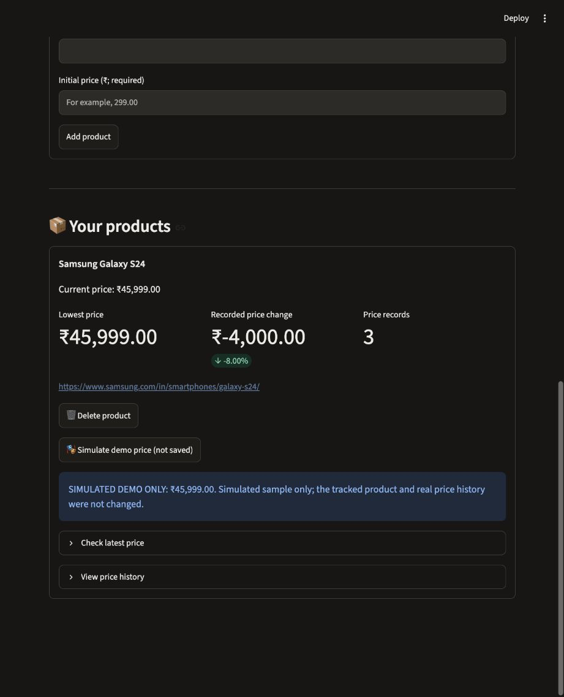
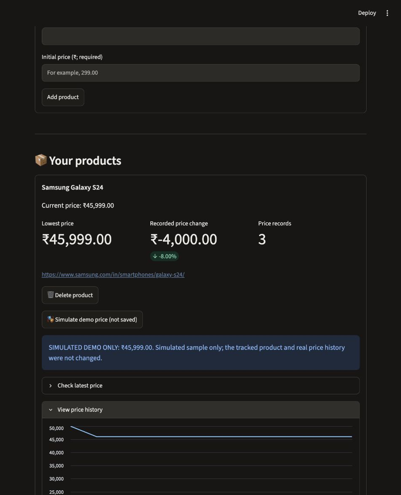
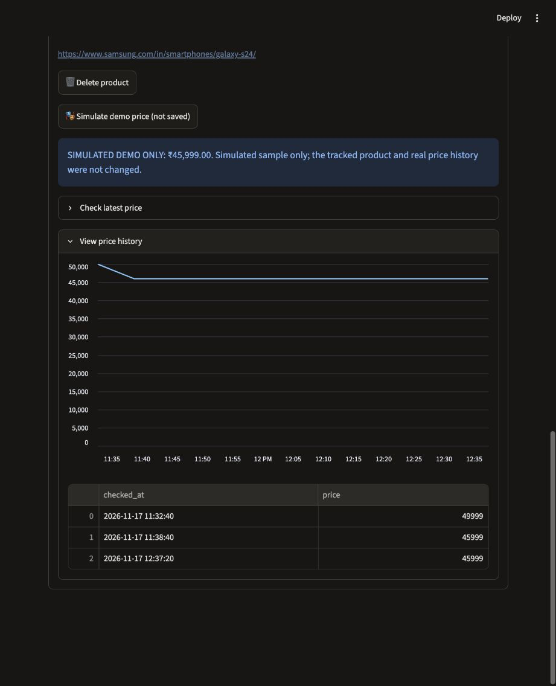
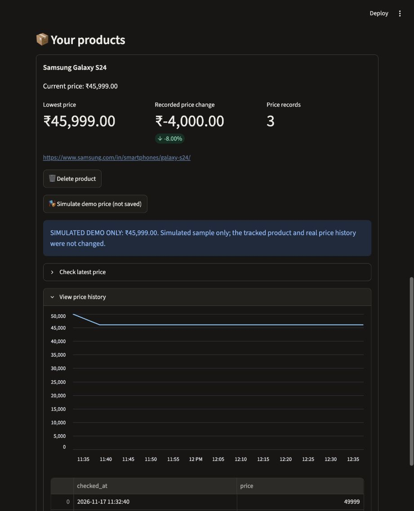

# Price Intelligence Tracker (PTI)

Price Intelligence Tracker is a small portfolio application for tracking product prices and reviewing retailer listings. It combines a FastAPI backend, a Streamlit dashboard, and a local SQLite database. Rewalto can provide external retailer listings and their latest reported observations.

## Problem

Prices can vary by retailer, location, product size, stock availability, and observation time. PTI keeps those details visible and only forms a cross-retailer comparison when the listings have a matching canonical product ID, brand, pack size, PIN, fresh INR price, and confirmed in-stock status.

## Features

- Add, list, view, and delete tracked products.
- Record a positive initial price and manually add later price observations.
- View price history, a history chart, the lowest recorded price, price change, and record count.
- Run a clearly labeled simulated demo price check. Demo values do not update tracked prices or history.
- Search Rewalto listings by retailer, PIN, exact brand, and an optional explicitly refined query.
- Verify product category from listing title/category evidence; brand filters, match kinds, and semantic similarity alone do not establish category. Unrelated or ambiguous listings are excluded from verified comparisons.
- Display listing relevance and price context; exclude irrelevant, unverified, stale, wrong-PIN, missing-price, and not-confirmed-in-stock listings from verified comparisons.
- Show a separate fixed Demo Price Comparison with clearly simulated prices; it never uses Rewalto results or SQLite price history.
- Keep external Rewalto search results separate from tracked products and local price history.

Product editing is not implemented yet. The API currently supports create, read, and delete operations for tracked products.

## Technology

- Python 3.10 or newer
- FastAPI and Pydantic
- Streamlit
- SQLAlchemy
- SQLite for local use; PostgreSQL can be selected with `DATABASE_URL`
- Rewalto API for external retailer listing search
- pytest and mocked responses for automated tests

## Architecture



### Main data flow

1. A user adds a tracked product with a positive initial price, or opens a tracked product in Streamlit.
2. FastAPI validates product and manual price-check requests and stores tracked product data and local price history through SQLAlchemy.
3. For external search, FastAPI calls Rewalto with the chosen query, retailer, optional exact brand, and optional PIN. External listings are returned for display; the search route does not save those listings to the local product tables.
4. The backend maps Rewalto's product identity, match metadata, latest price, currency, PIN, stock state, and observation time. The frontend validates freshness and location before displaying a usable price.
5. Comparison groups require verified relevance, the same canonical product ID, brand, variant when supplied, pack size, and PIN, plus a fresh positive INR price and confirmed in-stock status at two or more retailers.
6. Streamlit shows tracked-product history and analytics separately from external search results. Demo prices are labeled simulated and are never part of real history or retailer comparisons.
7. Product-category checks use explicit title/category evidence. Missing or ambiguous category evidence remains unverified; a canonical ID or search match does not override that status.

## Project structure

```text
.
├── .env.example             # Safe local configuration template
├── .gitignore               # Excludes local secrets, databases, and generated files
├── README.md
├── requirements.txt         # Runtime dependencies
├── requirements-dev.txt     # Test dependencies
├── backend/
│   ├── config.py            # Environment-based settings
│   ├── database.py          # SQLAlchemy engine and request sessions
│   ├── main.py              # FastAPI application and health endpoint
│   ├── models.py            # Product and price-history tables
│   ├── routes.py            # Product, price, and external-search endpoints
│   ├── schemas.py           # Pydantic validation and response schemas
│   └── services/
│       ├── demo_fetcher.py  # Simulated sample price source
│       ├── price_fetcher.py # Price-source interface
│       ├── rewalto_client.py # Rewalto HTTP client and safe error handling
│       └── *_test.py        # Explicit operator-run Rewalto checks
├── frontend/
│   ├── app.py               # Streamlit dashboard
│   └── comparison.py        # Price, location, freshness, and identity checks
├── docs/
│   └── screenshots/         # Genuine screenshots of the running dashboard
└── tests/
    ├── conftest.py          # Uses and removes a disposable database copy
    ├── test_api.py          # Mocked API and product-flow tests
    ├── test_comparison.py   # Pure comparison-validation tests
    └── test_rewalto_client.py # Mocked Rewalto client tests
```

The local `.venv/`, SQLite file, `.env` files, bytecode, and test caches are not part of the project source.

## Setup on macOS

Open Terminal and go to the project directory:

```bash
cd /path/to/PTI
python3 --version
python3 -m venv .venv
source .venv/bin/activate
python -m pip install --upgrade pip
pip install -r requirements.txt
pip install -r requirements-dev.txt
if [ ! -f .env ]; then cp .env.example .env; fi
```

Edit `.env` locally if you need to change settings. Do not commit `.env` or paste credentials into source files. Leave `REWALTO_API_KEY` blank if you are not using Rewalto; enter your own key locally when authorized to use the provider. Never put a real key in `.env.example`.

`DATABASE_URL` defaults to `sqlite:///./price_tracker.db`, a file in the project root. For PostgreSQL use, set `DATABASE_URL` to a PostgreSQL connection string and use the included PostgreSQL driver. PTI does not deploy or create a hosted database.

## Run locally

Open two terminals in the PTI project directory. Activate the virtual environment in each:

```bash
source .venv/bin/activate
```

In the first terminal, start FastAPI:

```bash
uvicorn backend.main:app --reload
```

The API is available at <http://127.0.0.1:8000>. Interactive API documentation is at <http://127.0.0.1:8000/docs>; the health endpoint is <http://127.0.0.1:8000/health>.

In the second terminal, start Streamlit:

```bash
streamlit run frontend/app.py
```

Streamlit normally serves the dashboard at <http://localhost:8501>. `BACKEND_API_URL` controls which FastAPI server the dashboard uses and defaults to `http://127.0.0.1:8000`.

## API overview

| Method | Endpoint | Purpose |
| --- | --- | --- |
| `GET` | `/health` | Check that FastAPI is running |
| `POST` | `/products` | Add a tracked product; a positive initial price is required |
| `GET` | `/products` | List tracked products |
| `GET` | `/products/{product_id}` | Get one tracked product |
| `DELETE` | `/products/{product_id}` | Delete a tracked product and its history |
| `POST` | `/products/{product_id}/check` | Record a manually entered price and update current price |
| `GET` | `/products/{product_id}/history` | Read a product's saved price observations |
| `POST` | `/products/{product_id}/auto-check` | Return a simulated sample; does not save it |
| `GET` | `/products/external-search` | Search external Rewalto listings |

There is no product update endpoint. Product creation and manual price observations reject zero or negative values. The current database schema requires `products.current_price` to be non-null, so a new product cannot be created with an unknown initial price. Existing non-positive legacy values, if present, are presented as unknown rather than as a zero price.

External search supports `q`, `retailer`, `pincode`, `limit`, `brand`, `mode`, and an optional `refined_query`. The refined query is explicit and is reported separately from the original query. `brand` is an exact, case-sensitive Rewalto filter. `mode=semantic` may return an unavailable error on deployments that do not support it; PTI does not silently switch search modes.

### Category relevance

PTI does not treat an exact brand filter, Rewalto match kind, or semantic similarity as proof that a listing belongs to the requested product category. For a milk query, clear milk-cake, honey, peda, and gift-pack results are marked irrelevant. A milk listing must include explicit drinking-milk evidence; missing or ambiguous evidence is marked unverified and excluded from verified price comparisons. The original listing details and Rewalto category/match metadata remain available for display. Rewalto's category tag may be missing or broad, so this conservative rule can leave valid but insufficiently described results unverified.

### Demo Price Comparison

The fixed sample compares Amul Taaza Toned Milk, 1 L at Blinkit (₹65), Zepto (₹62), and Instamart (₹68). It reports the lowest and highest prices and the ₹6 difference, with Zepto highlighted as the lowest. The section is labeled `SIMULATED DEMO DATA — NOT LIVE RETAILER PRICES`. Its rows are created locally for display only: they are not Rewalto results, tracked products, or SQLite price-history observations. The sample PIN, availability, and observation time are also simulated and do not describe current retailer coverage.

## Database

SQLite stores two tables:

- `products`: product name, URL, positive current price, and creation time.
- `price_history`: manually recorded price and check time, linked to a product.

FastAPI creates missing tables on startup. `create_all` is not a migration system and does not reset the database. No schema migrations are included. The local `price_tracker.db` file is ignored by Git and must not be deleted to reset the project.

External Rewalto search results are not written to either table. Tracked product history and external listing observations are separate data sources.

## Tests

Activate the project virtual environment, then run:

```bash
python -m pytest -q
```

The automated suite uses mocked Rewalto responses. `tests/conftest.py` copies the local SQLite database to a temporary file before tests and removes only that copy afterward. Ordinary pytest collection does not make live Rewalto requests. The scripts under `backend/services/` are explicit operator-run checks and may use Rewalto; they can consume API credits if listings are returned.

## Screenshots

These images were captured from the running Streamlit application using the existing local product and price-history records. The demo screen is clearly labeled simulated.

| Dashboard | Product management |
| --- | --- |
|  |  |

| Analytics and chart | Price history |
| --- | --- |
|  |  |



An empty Rewalto-search screenshot is not included: producing that screen would require submitting a search, and this verification run is restricted from making live Rewalto requests. No search result or comparison has been fabricated.

## Known limitations and current verification

- Rewalto data coverage is not guaranteed for every retailer, product, or PIN. An HTTP 200 response with no listings means no records were returned for that query; it does not prove that the retailer does not sell the product.
- The tested query `Amul Taaza toned milk 1 L` returned no Blinkit listings with PIN `121006`, and it also returned no listings without a PIN. Both empty responses reported zero credits charged.
- Live cross-retailer price comparison has not been verified with matching real retailer listings. Do not present it as demonstrated against current Rewalto data.
- Rewalto match metadata and canonical IDs improve identity checks, but do not provide a complete product-category taxonomy. Clear conflicts are rejected and category-ambiguous results remain unverified, which may exclude some valid listings until better category evidence is available.
- For external comparisons, a price must be positive INR, fresh within the application's seven-day comparison window, and for the requested PIN. Unknown prices, wrong-PIN prices, stale observations, and non-confirmed stock are not used as a lowest purchasable price.
- Demo price results are simulated samples only. They are not live retailer prices, and they do not change the tracked product price or history.
- Product editing is not implemented. Tracked product details can be added, viewed, and deleted.
- The empty-search screen has not been captured because no live Rewalto search was allowed during this verification. Capture it manually only when a search is authorized; an empty response does not prove product unavailability.

## GitHub and secrets

`.gitignore` excludes local environment files, API-key files, databases, virtual environments, Python bytecode, test caches, and operating-system metadata. `.env.example` contains only local defaults and an empty API-key setting. Keep credentials in a local ignored file or environment variable. Git has been initialized locally with no commits, so there was no earlier Git history to inspect. No files were committed or pushed, and no deployment or upload was performed.

## Future improvements

- Add product editing after the update workflow is specified and tested.
- Validate Rewalto product coverage and comparison behavior with authorized live listings across multiple retailers and PIN codes.
- Add a captured empty-search view after a live request is authorized, while keeping empty results distinct from confirmed unavailability.
